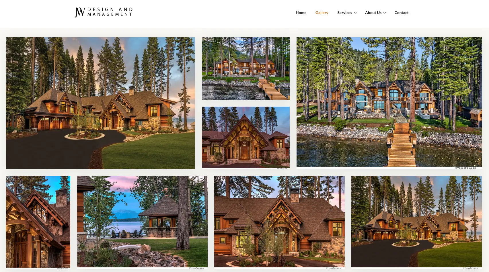
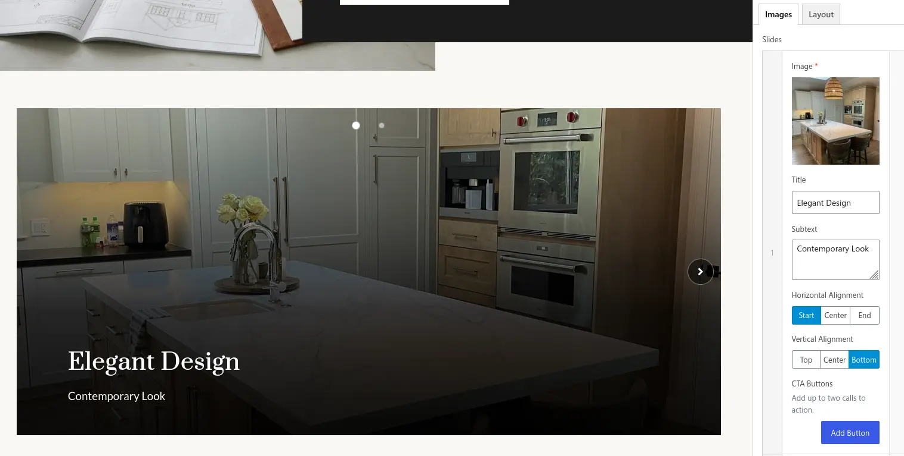
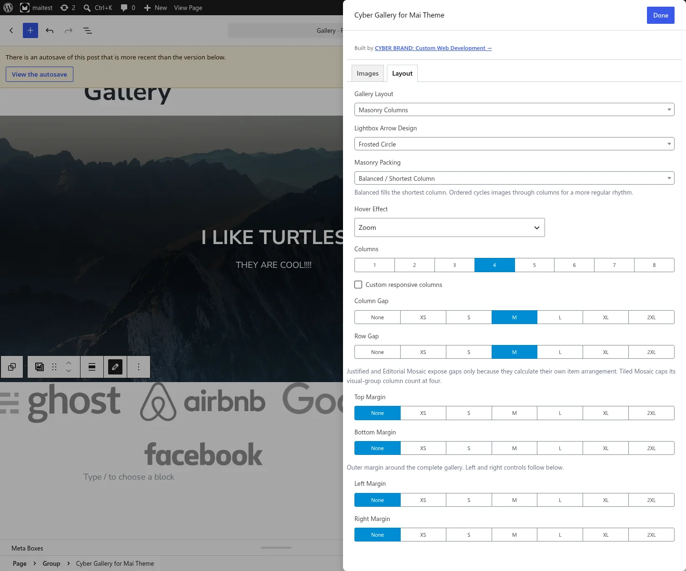

# Mai Cyber Gallery

Mai Cyber Gallery is a Mai Engine add-on with nine advanced image gallery layouts. It follows the same dynamic ACF block, responsive columns, image sizes, spacing controls, and Genesis markup APIs used by official Mai add-ons.

## Screenshots

<table>
	<tr>
		<td width="50%" valign="top">
			<a href="docs/images/tiled-mosaic.webp">
				
			</a>
			<br>
			<strong>Tiled Mosaic</strong> — ratio-aware rows and stacks preserve image order while filling the available canvas.
		</td>
		<td width="50%" valign="top">
			<a href="docs/images/filmstrip-logos.webp">
				
			</a>
			<br>
			<strong>Filmstrip for logos</strong> — mixed logo proportions align cleanly without forced cropping or empty global padding.
		</td>
	</tr>
	<tr>
		<td width="50%" valign="top">
			<a href="docs/images/slider-backend.webp">
				
			</a>
			<br>
			<strong>Live Slider editing</strong> — structured content controls update alongside the active slide preview.
		</td>
		<td width="50%" valign="top">
			<a href="docs/images/expanded-options.webp">
				
			</a>
			<br>
			<strong>Expanded design controls</strong> — packing, responsive columns, alignment, gaps, and four-sided spacing in one focused editor.
		</td>
	</tr>
</table>

## Requirements

- WordPress 6.5 or later
- PHP 8.3 or later
- Genesis Framework
- A Genesis child theme with Mai Engine support
- Mai Engine 2.40.0 or later

Mai Engine is a deliberate dependency. It supplies ACF Pro, responsive column controls, image sizes, sanitizers, design tokens, and the Genesis/Mai runtime.

## Related projects

- [maithemewp/mai-engine](https://github.com/maithemewp/mai-engine) — the required Mai framework and runtime.
- [maithemewp/mai-grid-gallery](https://github.com/maithemewp/mai-grid-gallery) — the official Mai gallery project whose conventions and legacy block format are relevant to interoperability and migration.

Mai Cyber Gallery is an independent add-on and is not presented as an official Mai Theme project.

Version 0.4.0 raises the WordPress and PHP minimums for compatibility-safe typing and development tooling. Saved block content, gallery settings, and public PHP API behavior are unchanged, so no content migration is required.

Version 0.4.1 adds Slider width modes and editor-control refinements. Existing content and settings require no migration; choose **Contained** to retain the previous centered maximum-width presentation.

Version 0.5.0 adds selectable Slider transitions, navigation hover treatments and Mai-aware colors, plus configurable image overlays.

Version 0.5.1 completes a source-level Mai Engine integration audit. ACF color migration/formatting, column defaults and sanitization, instance indexes, CSS unit formatting, the configured XL breakpoint, control foundations, shadows, icons, typography, palettes, and design tokens now delegate to Mai Engine wherever it exposes a matching implementation.

Version 0.6.0 gives Slider effects true in-place transitions instead of layering them over a horizontal slide, sharpens circle navigation, adds two independently combinable navigation slots, and adds accessible autoplay timing and hover-pause controls.

Version 0.7.0 preserves every layout's image source and dormant settings when layouts change, shares image overlays and hover treatments across layouts, and expands Filmstrip with accessible autoplay, optional and positionable arrows, and purpose-built logo normalization.

Version 0.7.1 moves per-image logo sizing next to the selected image's metadata, uses Mai Icons for lightbox controls when available, and removes the Filmstrip's visual scrollbar while preserving native scrolling.

Version 0.7.2 adds a discreet CYBER BRAND authorship and custom-development link to the block editor without adding settings screens, dashboard advertising, tracking, or front-end output.

Version 0.8.4 adds a native editor transform from the original Mai Gallery block, including its ordinary or custom-linked images and compatible Mai layout settings.

Version 0.9.0 expands Editorial Mosaic into configurable feature groups, adds new Masonry, Justified, and Tiled composition choices, and gives every layout independent margins on all four sides. Existing galleries keep their previous appearance until a new option is selected.

## Performance and page caching

Public gallery output is deterministic and works with full-page caches. Frontend behavior is natively deferred and divided into conditional packing-layout, carousel, and lightbox scripts. Masonry, Justified, and Tiled galleries do not download Filmstrip or Slider code; carousel pages do not download the packing algorithms; and the lightbox loads only when a rendered gallery uses the Lightbox click action. Dynamic preview and content updates are batched so multiple DOM mutations trigger one focused gallery pass instead of repeated document rescans.

LiteSpeed Cache integrations keep the natively deferred scripts out of interaction-delayed and Guest Mode rewrites, preserve JavaScript-only layout and dialog selectors during UCSS generation, and promote a newly selected Slider image through LiteSpeed's lazy loader before its transition begins. Gallery responses are tagged with their attachment IDs so changing an attachment's alt text or metadata purges only pages that rendered it. LiteSpeed image lazy loading and VPI remain available for untouched and offscreen images.

Cold-cache rendering primes attachment posts and metadata in bulk before building responsive image markup. Standard WordPress image functions remain responsible for dimensions, `srcset`, `sizes`, loading hints, and image URLs, retaining compatibility with CDN and WebP/AVIF rewriting.

## Building a release

Run `npm run build:zip` from the plugin directory. The command rebuilds and validates generated assets, runs the JavaScript and PHP checks, recreates a clean `build/mai-cyber-gallery/` staging directory, and writes `build/mai-cyber-gallery-{version}.zip`. The ZIP contains only runtime assets, PHP, block metadata, and user-facing documentation.

## Mai Engine integration boundary

Mai Cyber Gallery intentionally treats Mai Engine as its framework rather than merely a compatibility dependency. The plugin consumes Mai's ACF field clones, responsive column attributes, palette/color resolvers, image choices, sanitizers, counters, breakpoint and unit helpers, Genesis markup, buttons, utility classes, and CSS variables.

Gallery-specific responsibilities remain local because Mai Engine has no equivalent API: attachment normalization, masonry/justified/tiled placement, slider and filmstrip state, the dialog lightbox, accessibility lifecycle, transitions, and overlays. Cyber's integer `--cyber-columns-*` values are also intentional: Mai's standard `--columns-*` values are CSS fractions such as `1 / 3`, while CSS `column-count` and the packing algorithms require whole-number counts.

## Layouts

- **Mai Grid** — the familiar responsive Mai flex-column gallery.
- **Masonry Columns** — a natural-ratio waterfall with balanced shortest-column or regular source-ordered packing.
- **Justified Rows** — upload-order rows balanced around a configurable target height, with selectable final-row alignment.
- **Tiled Mosaic** — a ratio-aware, source-order mosaic with Organic, Calm, and Dense composition presets.
- **Editorial Mosaic** — configurable feature groups with 1–8 secondary images, deliberate odd-item alignment, selectable feature side, alternation, and tile height.
- **Square Tiles** — responsive 1:1 cropped tiles.
- **Circle Tiles** — responsive circular 1:1 tiles.
- **Filmstrip** — touch-friendly horizontal scroll snap with optional positioned controls, accessible timed movement, uniform crop cells, and a no-crop logo mode.
- **Slider** — a responsive content slider with per-slide titles, subtext, CTA buttons, horizontal and vertical content alignment, selectable transitions and navigation treatments, dimensions, image fit, and color overlays.

Non-Slider layouts use Mai's column/row gap controls. Grid, Masonry, Square, Circle, and Filmstrip also use Mai's responsive column counts; Tiled Mosaic uses those controls as a maximum of four visual groups. Every layout has independent top, right, bottom, and left outer margins using Mai's shared spacing scale.

## Editor usage

1. Activate Mai Engine and a Mai child theme.
2. Activate Mai Cyber Gallery.
3. Add the **Mai Cyber Gallery** block.
4. Choose a layout and use **Open Expanded Editor** to add gallery images or structured Slider rows.

An existing Core Gallery can be changed to **Mai Cyber Gallery** through the block toolbar's Transform menu. Conversion creates a Mai Grid gallery and preserves valid local attachment IDs in source order, columns, image size, crop orientation, supported link behavior, wide/full alignment, anchor, and custom class. Core-only data such as external images without attachment IDs, individual captions, focal points, per-image links, styling, and unsupported nested content is intentionally dropped. The original block remains unchanged when it has no convertible local attachments.

For non-Slider layouts, click actions include no link, the built-in dialog lightbox, the original media file, the attachment page, and per-image custom links.

For Masonry, Justified, and Tiled Mosaic, choose an uncropped image size such as `large`. Mai Grid and Filmstrip use Mai's selected image orientation when an oriented size exists.

Editorial Mosaic treats the first image as a feature, then places the selected 1–8 following images into the complementary mosaic before beginning another feature group. **Odd Remainder** can let an unpaired final secondary fill its row or align it to Start, Center, or End. You can also choose the first feature side, alternate sides by group, and keep the responsive automatic tile height or set a fixed height. A group of four secondary images with Fill and automatic height is the original five-image design.

Masonry can balance every new image into the currently shortest column or cycle items through columns for a more regular source-order rhythm. Justified Rows can align its un-stretched final row to Start, Center, or End. Tiled Mosaic offers Organic Mix, Calm Bands, and Dense Stacks presets; the responsive column count remains its maximum number of visual groups.

When the click action is Lightbox, choose Frosted Circle, Rounded Square, Minimal Chevron, or Edge Tab navigation arrows. The controls keep a stable hit target across hover, focus, and active states.

Slider uses a dedicated **Slides** repeater. Every row has a required image plus optional title, plain-text subtext, Start/Center/End horizontal alignment, Top/Center/Bottom vertical alignment, and up to two CTA links. Vertical alignment defaults to Bottom. CTA styles reuse Mai Engine's Primary Button, Secondary Button, Outline Button, and Link Button styles. Slide images are intentionally non-interactive so CTAs remain the only destinations; Media Library captions are replaced by the structured slide content. Editor preview refreshes preserve the currently selected slide, allowing its content and effect to remain visible while fields are edited.

Switching between Slider and another layout is non-destructive. The block keeps ordinary Images, Linked Images, structured Slides, and layout-specific settings serialized while they are hidden. Slider renders only its structured Slides rows, so an empty Slider shows its setup prompt instead of stale content from the previous layout; returning to another layout restores its retained images and settings.

Slider has Primary and Secondary Navigation selectors. Each can use Arrows, Circles, Slide Counter, or None, so combinations such as Arrows + Circles and Circles + Counter are possible. Choosing the same control twice renders it only once, and the editor prevents duplicate selections. Navigation can overlay the images or appear below them, and overlay circles can sit at the top or bottom. Slider controls also set the arrow design, width mode, maximum width, desktop height, mobile height, and whether images crop to fill or fit completely inside the slide. Column, gallery alignment, and gap controls are hidden because a Slider always displays one full-width slide.

Slider transitions include Smooth Slide (`native`), Fade, Zoom In, Zoom Out, Rise, Soft Focus, Reveal, and Cinematic. Smooth Slide uses native horizontal scrolling. Controls and autoplay render every other preset as an in-place crossfade, with the selected entrance treatment layered into that crossfade instead of exposing an underlying slide. Direct touch and trackpad gestures remain native. The animated presets use Fast, Normal, and Slow speeds, and motion is removed when the visitor requests reduced motion.

Optional autoplay uses a configurable 3–30 second interval and can pause while the pointer is over the Slider. Its Pause/Start control can be shown or hidden independently without disabling rotation. Reduced-motion preferences disable rotation and hide its unnecessary toggle. Keyboard focus and manual navigation stop rotation until the visitor explicitly starts it again when the control is available.

Navigation hover choices are Color Shift, Grow, Nudge, Glow, Fill, and Ring. Main, border, and inner colors can each be set independently for normal and hover states using the Mai Engine palette or a custom color. Hover treatments preserve the navigation controls' hit targets.

Image overlays are shared by every layout and support None, Solid, Gradient Bottom, Gradient Top, Gradient Left, Gradient Right, and Vignette styles. Overlay color uses the Mai Engine palette or a custom color, and opacity can be set from 0 through 100. In Slider this treatment remains separate from the content-legibility scrim used behind slide copy and CTAs.

Hover treatments are also shared across layouts. Desaturate removes a configurable 0–100 percent of color at rest and restores full color on mouse-over or keyboard focus. Zoom, Lift, Fade, and None remain available, and reduced-motion preferences suppress movement. Slider defaults to None so existing Sliders do not gain motion until a treatment is deliberately selected; other layouts retain the existing Zoom default.

Filmstrip controls can be hidden as a group, while arrows are opt-in and can be enabled independently. Visible controls can sit over the images or align above/below them at Start, Center, or End. Arrow design, hover treatment, and Mai palette/custom navigation colors are shared with Slider, including the autoplay control. Optional timed movement advances one item by default, supports a configurable items-per-advance value, and wraps at the end even when controls are hidden. Touch swipes and mouse/pen throws use restrained momentum, subtle edge stretch and tilt, and a light elastic snap to the closest item; autoplay, arrows, and keyboard navigation use a calm no-overshoot glide. Rotation pauses for manual interaction, keyboard focus, hidden tabs, offscreen galleries, reduced-motion preferences, and optionally mouse-over.

For mixed logo rows, choose **Logo / Contain**. Every item receives the same responsive cell height while each source keeps its intrinsic aspect ratio and centers within an explicit rail-height constraint. Shared padding is optional rather than necessary for containment, and any selected hard-cropped preset automatically falls back to the uncropped original. Select an image in the **Images** field and enable **Use a custom size for this image** beside its Title, Caption, and other metadata when unusual transparent whitespace makes that logo look optically small or large. Linked Images expose the same checkbox below each image. The setting belongs only to the current gallery; values above 100 percent deliberately zoom within the fixed cell and can clip if pushed too far. **Uniform Crop** provides equal-height photographic cells, while **Natural** preserves the original Filmstrip behavior.

Slider width modes are **Full**, **Contained**, and **Inset**. Full is the default and fills the available block or parent canvas. Contained applies **Maximum Slider Width** and preserves the previous centered presentation. Inset fills the canvas while retaining responsive side gutters. In the compact block inspector, maximum width and the desktop and mobile height fields stack one per row; the expanded editor keeps those three fields together in one row. Their number inputs retain validation but omit browser up/down spinner controls. Button-group choices use equal widths throughout the gallery controls.

**Image Quality / Source Size** selects the WordPress image source used in the responsive image markup. Choose a source at least as large as the displayed image: larger sources can look sharper but use more bandwidth. Slider dimensions control the display box independently.

**Image Corners** switches gallery images between Square and Rounded corners. Circle Tiles remain circular.

## Converting existing galleries

Select an existing **Mai Gallery** or **Gallery** block in the WordPress editor, open the block-type/Transform menu at the left of its toolbar, and choose **Mai Cyber Gallery**. The selected block is immediately replaced with a Cyber Gallery using the familiar **Mai Grid** layout; WordPress Undo can restore the original until the post is saved.

The Mai Gallery conversion preserves the active ordinary-image gallery or custom-linked-image repeater in source order, plus lightbox behavior, shadow, image orientation and custom source size, captions, hover behavior, responsive column counts, column alignment, gaps, margins, wide/full alignment, anchor, and custom class where available. An old custom URL becomes the corresponding Cyber linked-image URL. The original Mai Galleries plugin must be active while its block is loaded in the editor, but it can remain installed alongside Cyber Gallery.

Core Gallery conversion preserves local attachment order, valid IDs, columns, image size, crop orientation, supported gallery-level link behavior, wide/full alignment, anchor, and custom class. Data without a direct Cyber equivalent is intentionally omitted. A source gallery with no valid attachments remains unchanged.

## PHP API

```php
echo mai_get_cyber_gallery(
	[
		'layout'       => 'masonry',
		'images'       => [ 123, 456, 789 ],
		'click_action' => 'lightbox',
		'columns'      => 3,
		'column_gap'   => 'md',
		'row_gap'      => 'md',
	]
);
```

`mai_do_cyber_gallery( $args )` is the echoing equivalent.

Slider uses structured rows rather than the gallery image arrays:

```php
echo mai_get_cyber_gallery(
	[
		'layout'                       => 'slider',
		'slider_width_mode'            => 'full',
		'slider_transition'            => 'cinematic',
		'slider_transition_speed'      => 'normal',
		'slider_navigation'            => 'arrows',
		'slider_navigation_secondary'  => 'dots',
		'slider_navigation_hover'      => 'glow',
		'slider_autoplay'              => true,
		'slider_autoplay_control'      => false,
		'slider_autoplay_interval'     => 5,
		'slider_pause_on_hover'        => true,
		'slider_overlay_style'         => 'gradient-bottom',
		'slider_overlay_color'         => 'black',
		'slider_overlay_opacity'       => 35,
		'slides'                       => [
			[
				'image'          => 123,
				'title'          => 'Build something memorable',
				'subtext'        => 'A concise supporting message that remains readable at every breakpoint.',
				'align'          => 'start',
				'align_vertical' => 'bottom',
				'buttons'        => [
					[
						'link'  => [
							'url'    => 'https://example.com/',
							'title'  => 'Start a Project',
							'target' => '',
						],
						'style' => 'button',
					],
				],
			],
		],
	]
);
```

### Gallery arguments

| Argument | Default | Accepted value |
| --- | --- | --- |
| `id` | generated | Optional HTML ID; `anchor` takes precedence. |
| `anchor` | empty | Block/API anchor ID. |
| `class` | empty | Space-separated additional classes. |
| `align` | empty | Empty, `wide`, or `full`. |
| `layout` | `masonry` | `grid`, `masonry`, `justified`, `tiled`, `mosaic`, `square`, `circle`, `filmstrip`, or `slider`. |
| `masonry_flow` | `balanced` | `balanced` places each image in the shortest column; `ordered` cycles through columns. |
| `justified_row_height` | `240` | Target pixel height from 100 through 600. |
| `justified_last_row` | `start` | `start`, `center`, or `end`; aligns the un-stretched final row. |
| `tiled_pattern` | `organic` | `organic`, `calm`, or `dense`; controls how frequently Tiled rows use stacked groups. |
| `mosaic_feature_side` | `left` | `left` or `right`; positions the first feature tile and sets the starting side. |
| `mosaic_alternate` | `false` | Boolean; swaps the feature side for each configured image group. |
| `mosaic_items_after_feature` | `4` | Whole number from 1 through 8; secondary images placed after each feature. |
| `mosaic_odd_alignment` | `fill` | `fill`, `start`, `center`, or `end`; treats the unpaired final secondary in an odd group. |
| `mosaic_row_height` | `0` | Mosaic row height from 0 through 600 pixels; `0` uses the responsive automatic height. |
| `click_action` | `lightbox` | `none`, `lightbox`, `media`, `attachment`, or `custom`. Slider never creates image links. |
| `lightbox_arrow_style` | `circle` | `circle`, `square`, `minimal`, or `edge`; used by non-Slider lightboxes. |
| `images` | empty array | Ordered attachment IDs used by non-custom galleries. |
| `images_links` | empty array | Image/link rows used by `click_action=custom`; schema shown below. |
| `slides` | empty array | Structured Slider rows and a retained-image fallback for other empty layouts. Each accepts `image`, `title`, `subtext`, horizontal `align` (`start`, `center`, or `end`), vertical `align_vertical` (`top`, `center`, or `bottom`; default `bottom`), and up to two `buttons`. |
| `image_orientation` | `landscape` | A Mai image-orientation slug or `custom`; used by Grid and Filmstrip Natural/Uniform Crop modes, but intentionally ignored by Logo / Contain. |
| `image_size` | `large` | Any registered WordPress image-size slug. This controls source dimensions and quality, not the rendered display box; Logo / Contain replaces a registered hard crop with `full`. |
| `image_radius` | `rounded` | `square` or `rounded`. Circle Tiles always remain circular. |
| `captions` | `below` | `none`, `below`, or `overlay`; ignored by Slider, whose custom copy replaces captions. |
| `shadow` | `false` | Boolean value sanitized by Mai Engine. |
| `hover` | `zoom` (`none` for Slider when omitted) | `none`, `zoom`, `lift`, `fade`, or `desaturate`; available to every layout. |
| `hover_desaturate_amount` | `100` | Color removal from 0 through 100 percent at rest when `hover=desaturate`; full color returns on hover or focus. |
| `filmstrip_autoplay` | `false` | Boolean; advances the Filmstrip automatically. |
| `filmstrip_autoplay_interval` | `5` | Seconds between automatic Filmstrip movements, accepted in 0.1-second increments from 0.1 through 30. |
| `filmstrip_autoplay_items` | `1` | Positive whole number of Filmstrip items advanced by each automatic movement. |
| `filmstrip_pause_on_hover` | `true` | Boolean; temporarily pauses Filmstrip autoplay while a mouse or pen is over it. |
| `filmstrip_controls` | `true` | Boolean; shows or hides the complete Filmstrip control group without disabling autoplay. |
| `filmstrip_arrows` | `false` | Boolean; opts into Filmstrip previous/next controls. |
| `filmstrip_arrow_position` | `below-end` | Positions Filmstrip controls at `overlay`, `above-start`, `above-center`, `above-end`, `below-start`, `below-center`, or `below-end`. |
| `filmstrip_arrow_style` | `circle` | `circle`, `square`, `minimal`, or `edge`. |
| `filmstrip_image_mode` | `natural` | `natural`, equal-height `uniform-cover`, or no-crop `logo-contain`. |
| `filmstrip_height` | `320` | Desktop cell height in pixels from 120 through 800 for uniform and logo modes. |
| `filmstrip_height_mobile` | `220` | Mobile cell height in pixels from 100 through 600 for uniform and logo modes. |
| `filmstrip_logo_padding` | `24` | Legacy shared padding fallback retained for existing galleries and PHP API calls. |
| `filmstrip_logo_padding_horizontal` | shared padding | Optional left/right breathing room in pixels from 0 through 120. |
| `filmstrip_logo_padding_vertical` | shared padding | Optional top/bottom breathing room in pixels from 0 through 120. |
| `filmstrip_logo_overrides` | empty array | Rows containing an `image` attachment ID and optical `scale` from 50 through 200 percent; the last row for a repeated ID wins. |
| `slider_navigation` | `arrows` | Primary navigation: `arrows`, `dots`, `counter`, or `none`. The legacy aggregate `arrows-dots` value remains accepted and maps to Arrows + Circles. |
| `slider_navigation_secondary` | `dots` | Secondary navigation: `arrows`, `dots`, `counter`, or `none`. A duplicate of the primary value is reduced to `none`. |
| `slider_navigation_position` | `overlay` | `overlay` or `below`. |
| `slider_dots_position` | `top` | `top` or `bottom`; applies to circle navigation when it overlays the image. |
| `slider_arrow_style` | `circle` | `circle`, `square`, `minimal`, or `edge`; used by navigation modes that include arrows. |
| `slider_transition` | `native` | `native`, `fade`, `zoom-in`, `zoom-out`, `rise`, `soft-focus`, `reveal`, or `cinematic`. |
| `slider_transition_speed` | `normal` | `fast`, `normal`, or `slow`; applies to in-place animated transitions while `native` keeps browser scroll timing. |
| `slider_autoplay` | `false` | Boolean; automatically advances and wraps the Slider when enabled. |
| `slider_autoplay_control` | `true` | Boolean; shows or hides the Slider Pause / Start button without disabling autoplay. |
| `slider_autoplay_interval` | `5` | Seconds between automatic slides, clamped from 3 through 30. |
| `slider_pause_on_hover` | `true` | Boolean; temporarily pauses autoplay while a mouse or pen pointer is over the Slider. |
| `slider_navigation_hover` | `color` | `color`, `grow`, `nudge`, `glow`, `fill`, or `ring`; shared by interactive Slider and Filmstrip navigation. |
| `slider_navigation_main`, `slider_navigation_border`, `slider_navigation_inner` | empty/site default | A Mai Engine palette slug or custom color for Slider and Filmstrip navigation background, border, and inner icon/text/dot. |
| `slider_navigation_main_hover`, `slider_navigation_border_hover`, `slider_navigation_inner_hover` | empty/site default | A Mai Engine palette slug or custom color for the corresponding navigation hover state. |
| `slider_overlay_style` | `none` | Shared image overlay: `none`, `solid`, `gradient-bottom`, `gradient-top`, `gradient-left`, `gradient-right`, or `vignette`. The legacy name is retained for compatibility. |
| `slider_overlay_color` | `black` | A Mai Engine palette slug or custom shared overlay color. |
| `slider_overlay_opacity` | `35` | Shared overlay opacity from 0 through 100. |
| `slider_width_mode` | `full` | `full` fills the available block or parent canvas, `contained` uses `slider_width`, and `inset` fills the canvas with responsive side gutters. |
| `slider_width` | Mai XL breakpoint (typically `1200`) | Maximum Slider width in pixels from 0 through 2400 when `slider_width_mode` is `contained`; `0` removes the maximum. |
| `slider_height` | `560` | Desktop slider height in pixels from 320 through 1200. |
| `slider_height_mobile` | `320` | Mobile slider height in pixels from 280 through 800. |
| `slider_image_fit` | `cover` | `cover` crops to fill the slide; `contain` shows the complete image. |
| `columns` | Mai default (`3`) | Main column count from 1 through 8; ignored by Slider. |
| `columns_responsive` | Mai default (`false`) | Use explicit breakpoint counts when true; ignored by Slider. |
| `columns_md`, `columns_sm`, `columns_xs` | Mai defaults | Explicit breakpoint counts; ignored by Slider. |
| `align_columns`, `align_columns_vertical` | Mai defaults | Mai column-alignment values; ignored by Slider. |
| `column_gap`, `row_gap` | Mai defaults | Mai spacing-size slugs or empty for no gap; ignored by Slider. |
| `margin_top`, `margin_right`, `margin_bottom`, `margin_left` | Mai defaults | Independent outer-margin values using a Mai spacing-size slug or empty. |

For backward compatibility, a PHP API call that explicitly supplies an atomic `slider_navigation` value but omits `slider_navigation_secondary` keeps that original single-control behavior. Pass both arguments to opt into a combination. The legacy `arrows-dots` aggregate continues to map to Arrows + Circles.

Custom links use the same array shape returned by ACF's Link field:

```php
echo mai_get_cyber_gallery(
	[
		'layout'       => 'filmstrip',
		'click_action' => 'custom',
		'images_links' => [
			[
				'image' => 123,
				'link'  => [
					'url'    => 'https://example.com/',
					'title'  => 'Visit the project',
					'target' => '_blank',
				],
			],
		],
	]
);
```

Slider button styles accept `button`, `button_secondary`, `button_outline`, or `button_link`. A button row is discarded unless its ACF-style `link` array contains both a valid URL and visible title. Only `_blank` targets are retained, and Slider rows are limited to two valid buttons. If the choices filter removes the primary `button` style, its first valid replacement becomes the editor and API fallback.

The helpers are available after Mai Engine has set up the theme. A gallery rendered through the block is detected early and gets its critical assets in the document head. If a theme template will render a Masonry, Justified, Tiled Mosaic, Filmstrip, Slider, or lightbox gallery through the PHP API after `wp_head`, enqueue the registered `mai-cyber-gallery` style and script handles from `wp_enqueue_scripts` so the first layout is ready before paint.

## Extension points

- `mai_cyber_gallery_layouts( array $layouts ): array` filters layout slug/label pairs. A custom layout must supply its own CSS and behavior.
- `mai_cyber_gallery_arrow_styles( array $styles ): array` filters the arrow design slug/label pairs shared by the lightbox, Slider, and Filmstrip.
- `mai_cyber_gallery_slider_navigation_choices( array $choices ): array` filters the atomic Slider navigation choices shared by the Primary and Secondary selectors.
- `mai_cyber_gallery_slider_transition_choices( array $choices ): array` filters Slider transition slug/label pairs.
- `mai_cyber_gallery_slider_transition_speed_choices( array $choices ): array` filters Slider transition-speed slug/label pairs.
- `mai_cyber_gallery_slider_navigation_hover_choices( array $choices ): array` filters shared Slider/Filmstrip navigation-hover slug/label pairs.
- `mai_cyber_gallery_slider_overlay_style_choices( array $choices ): array` filters shared image-overlay style slug/label pairs; the original hook name remains stable.
- `mai_cyber_gallery_button_style_choices( array $choices ): array` filters Slider CTA style slug/label pairs.
- `mai_cyber_gallery_button_style_classes( array $styles ): array` filters CTA style-to-class mappings.
- `mai_cyber_gallery_args( array $args ): array` filters parsed arguments before sanitization.
- `mai_cyber_gallery_image_size( string $image_size, array $args ): string` filters the thumbnail size.
- `mai_cyber_gallery_item( array $item, array $args ): array` filters each normalized item.
- `mai_cyber_gallery_items( array $items, array $args ): array` filters the complete ordered item list.

An item contains `id`, rendered `image` HTML, `caption`, `alt`, attachment `title`, numeric `ratio`, `width`, `height`, and a `link` array. Slider items also contain sanitized `slide_title`, `slide_subtext`, `slide_align`, `slide_align_vertical`, and `slide_buttons`. Entries returned by the all-items filter are normalized again; non-array entries and entries without image HTML are discarded.

Genesis attribute filters are available for the `mai-cyber-gallery`, `mai-cyber-gallery-items`, `mai-cyber-gallery-item`, and `mai-cyber-gallery-image-link` contexts. The standard Genesis markup open/content/close filters are available for the first three contexts; the image link uses `genesis_attr()` only.

Every Cyber-owned PHP symbol, ACF field key, block name, asset handle, CSS selector, and Genesis context is distinct from Mai Galleries, so both plugins can be active during migration.

## Design notes

- Thumbnail markup comes from `wp_get_attachment_image()` so WordPress controls intrinsic dimensions, responsive sources, lazy loading, decoding, and fetch priority.
- Shared controls inherit Mai's button foundation and variables, lightbox glyphs use Mai Icons when available, image shadows use Mai's `has-drop-shadow` utility, and Slider copy inherits Mai typography and dark-background rules.
- Masonry progressively enhances its CSS multi-column fallback with a shortest-column layout that preserves source order and removes avoidable holes.
- Justified Rows progressively enhances the normal Mai grid and recalculates through `ResizeObserver`.
- Tiled Mosaic uses image ratios to build mixed, close-packed groups while preserving source order.
- Filmstrip keeps native scrolling and scroll snap as its baseline while hiding browser scrollbar chrome; optional accessible autoplay layers on top without taking away touch, mouse, trackpad, or keyboard control.
- Slider uses canonical content rows, a responsive contrast scrim, Mai-styled CTAs, native scroll snap, keyboard navigation, counters, titled status updates, and optional accessible autoplay.
- Non-native Slider presets use an in-place transition compositor for controls and autoplay; direct gestures retain native scrolling. Transitions and navigation hover effects honor `prefers-reduced-motion`.
- Shared image overlays use Mai Engine palette colors when selected and remain separate from Slider's content-legibility scrim.
- The lightbox uses the browser's modal `<dialog>` behavior, supports Escape/arrow/Home/End keys, offers four arrow designs, and returns focus to its trigger.
- No updater is bundled until this fork has its own release repository. It will never use the upstream Mai Galleries update channel.

## License

Copyright © 2026 Aleksandr Oreshkin.

Licensed under the [GNU General Public License, version 2 or any later version](LICENSE). See [NOTICE](NOTICE) for the applied copyright and warranty notice.
